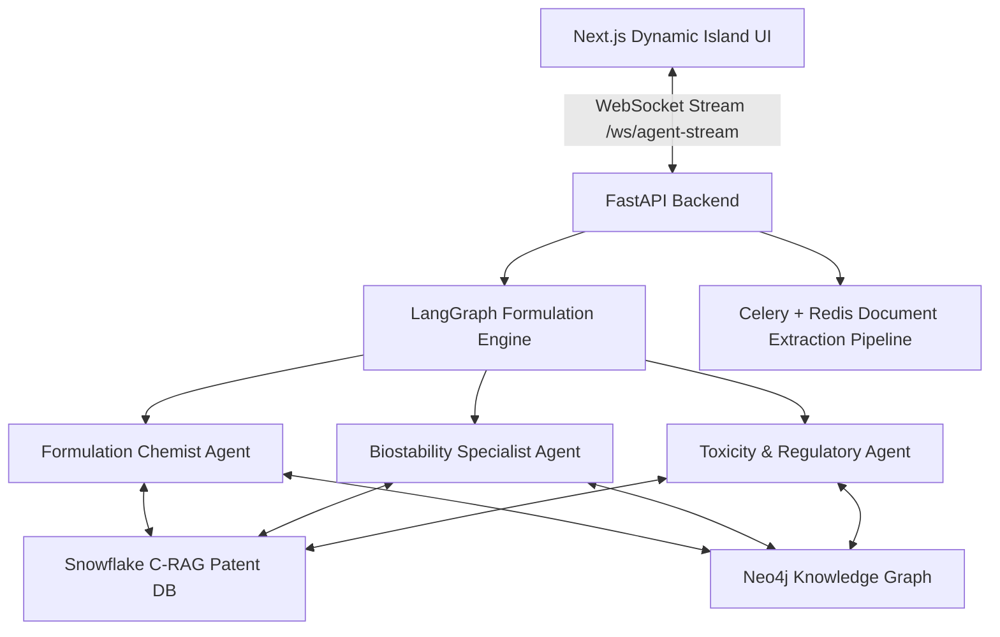

# FormulaAI — Agentic Agro-Chemical Formulation Platform

FormulaAI is an enterprise-grade agentic AI system for designing, optimizing, and compliance-validating agrochemical formulations (chemical, microbial, peptide, and RNAi) using multi-agent orchestration, knowledge graph grounding, and enterprise patent C-RAG.

---

## 🏛️ Architecture Overview



### Key Pillars
1. **Multi-Agent StateGraph (`backend/agents/`)**:
   - **Formulation Chemist**: Evaluates active ingredients, excipients, solvents, and emulsifiers.
   - **Biostability Expert**: Analyzes UV/temperature stability, shelf life, and microbial viability.
   - **Toxicity & Regulatory Expert**: Screens ingredients against EPA INERT / regulatory standards and approves the final recipe.
2. **Enterprise Patent C-RAG (`backend/database/`)**:
   - Queries real global patent abstracts and claims (USPTO, INPI Brazil, EPO) stored in Snowflake `FORMULA_KNOWLEDGE_DB.GLOBAL_PATENTS`.
   - Generates verifiable citations for every suggested recipe component.
3. **Chemical & Biological Normalization (`backend/normalization/`)**:
   - Resolves SMILES, LogP, and chemical properties with RDKit and PubChem.
   - Normalizes microbial active ingredients and pathogens with NCBI Taxonomy.
4. **Real-time Glassmorphic UI (`frontend/`)**:
   - Built with Next.js, Tailwind CSS, and Dynamic Island activity stream over WebSockets.

---

## 🚀 Quickstart

### 1. Prerequisites
- **Python 3.11+**
- **Node.js 18+** & `npm`
- *(Optional for full persistence)*: Docker Desktop for Neo4j & Redis, Snowflake Account for patent queries.

### 2. Backend Setup

```powershell
# Navigate to backend
cd backend

# Create & activate virtual environment (using uv or python)
uv venv --python 3.11 venv
.\venv\Scripts\activate

# Install dependencies
uv pip install -r requirements.txt

# Configure environment
cp ../.env.example .env
# Edit .env with your GEMINI_API_KEY and optional Snowflake / Neo4j credentials
```

#### Run the Backend Server:
```powershell
uvicorn main:app --reload --reload-exclude "venv" --port 8000
```
- API Docs: [http://127.0.0.1:8000/docs](http://127.0.0.1:8000/docs)
- Health Check: [http://127.0.0.1:8000/health](http://127.0.0.1:8000/health)

### 3. Frontend Setup

```powershell
# Open a new terminal and navigate to frontend
cd frontend

# Install packages
npm install

# Run development server
npm run dev
```
Open **[http://localhost:3000](http://localhost:3000)** in your browser.

---

## ❄️ Snowflake Patent Database Provisioning (Optional)

To initialize the Snowflake patent repository:
1. Log into your Snowflake account as `ACCOUNTADMIN`.
2. Run the provisioning script located at:
   ```
   backend/database/snowflake_init.sql
   ```
3. Set your credentials in `backend/.env`:
   ```ini
   SNOWFLAKE_ACCOUNT=<your_account_identifier>
   SNOWFLAKE_USER=<your_username>
   SNOWFLAKE_PASSWORD=<your_password>
   SNOWFLAKE_WAREHOUSE=FORMULA_APP_WH
   SNOWFLAKE_DATABASE=FORMULA_KNOWLEDGE_DB
   SNOWFLAKE_SCHEMA=GLOBAL_PATENTS
   ```
*(Note: If Snowflake or Neo4j are offline, FormulaAI runs in graceful degraded mode with offline mock fallback data).*

---

## 🧪 Running Tests

```powershell
cd backend
venv\Scripts\python.exe -m pytest tests/
```

---

## 📄 License
MIT License.
